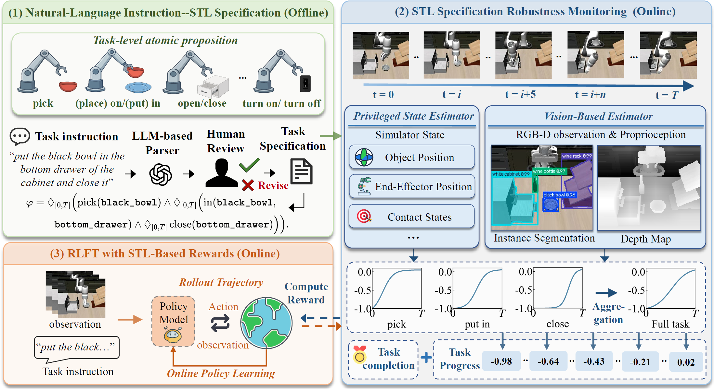

# SpecRL: Specification-Guided Dense Rewards for VLA Reinforcement Learning

<p align="center">
  
</p>

This bundle contains the implementation used by the SpecRL experiments. SpecRL
provides specification-guided dense rewards for reinforcement learning
fine-tuning of vision-language-action (VLA) models.

## Abstract

Reinforcement learning fine-tuning (RLFT) has emerged as a promising approach
for adapting pretrained vision-language-action (VLA) models through
task-directed interaction. However, many existing methods rely on sparse binary
rewards, which provide limited guidance for policy optimization and thereby
hinder learning performance. While recent approaches seek denser feedback via
LLM-generated reward functions or vision-language model evaluations, they are
often inefficient and the resulting rewards are often unreliable, potentially
introducing errors that misguide policy optimization.

In this work, we propose SpecRL, a specification-guided framework designed to
provide dense, interpretable online rewards for RLFT. The core idea is to
formalize task requirements in Signal Temporal Logic (STL) and derive rewards
from its explicit quantitative semantics. Specifically, SpecRL leverages an
LLM-aided process to convert language instructions into STL specifications
constituted by task-level atomic propositions. During execution, SpecRL
evaluates proposition satisfaction using either a privileged-state grounding or
a lightweight visual grounding module, supporting both simulation and
real-world deployments. A runtime monitor then aggregates the quantitative
values of propositions along the specification's temporal structure,
translating fine-grained task progress into dense rewards for online policy
fine-tuning. Extensive evaluations on the LIBERO benchmark show that
privileged-state SpecRL improves the success rate over binary-reward RLFT by
$3.3$ percentage points, while visual SpecRL surpasses the strongest visual
baseline by $4.8$ percentage points with $1.43\times$ faster training. Real-world
trajectory evaluations further demonstrate that its deterministic and
interpretable design delivers more accurate reward feedback than baselines.

## Framework Architecture

The pipeline has two stages:

1. **Offline instruction parsing:** an LLM converts natural-language
  instructions into structured JSON task representations containing STL-style
  atomic propositions.
2. **Online grounding and monitoring:** the propositions are evaluated against
  privileged simulator state or visual observations, then aggregated into
  continuous dense rewards for policy optimization.

## Requirements

- Python 3.11.14.
- PyTorch 2.6.
- Ubuntu 22.04.4 LTS for the provided training launchers.
- NVIDIA CUDA runtime with eight GPUs; NVIDIA A100 80 GB GPUs are recommended
  for VLA training.

## Quick Start & Usage

You can run the training experiments with:

```bash
# 1. Privileged-state grounding (`SpecRL_P`)
bash scripts/run_ppo_8gpu_SpecRL_P.sh

# 2. Lightweight visual grounding (`SpecRL_V`)
bash scripts/run_ppo_8gpu_SpecRL_V.sh goal
```

## Repository Contents
- `scripts/`: Training launchers and visual grounding service scripts.
- `examples/`: Shared training entry points, runtime hooks, and configuration files.
- `rlinf/`: Runtime source code required for SpecRL execution (pre-configured for LIBERO).
- `llm_symbolic_parity.py`: Online structural-parity evaluation script for the LIBERO benchmark.

## External Assets & Environment Setup
**Notice:** The training/visual environments and weight files will be released at a later date.

Running this bundle requires supplying the following external assets and environment configurations:

- `.venv_embodied_openpi` (training environment)
- `.yoloe_venv` (YOLOE environment)
- OpenPI SFT checkpoint
- `OPENPI_DATA_HOME` environment variable
- YOLOE weights
- LIBERO benchmark dependencies and assets


